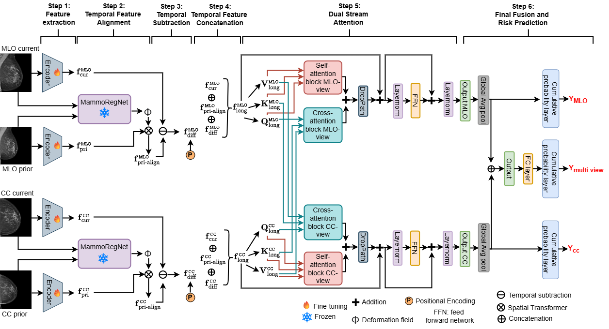

# Longitudinal Multi-View Modeling for Breast Cancer Risk Prediction

This is the code for our MICCAI 2026 submission.

## Table of Contents
1. 📘 [Introduction](#introduction)  
2. ⚙️ [Method](#method)  
3. 🔍 [Key findings of the paper](#key-findings-of-the-paper)  
4. 📚 [Datasets](#datasets)  
5. ▶️ [Reproduction of the results](#reproduction-of-the-results)  
6. 📄 [Citation](#citation)  

## Introduction
Accurate breast cancer risk prediction is essential for personalized screening and early detection. Existing methods often fail to fully model the complementary information between CC and MLO views over time, limiting their ability to capture spatial–temporal interactions. LMV-Net addresses this gap by jointly analyzing complementary mammographic views across multiple screening time points. Evaluated on the EMBED and CSAW-CC datasets, LMV-Net outperforms state-of-the-art methods, demonstrating improved risk prediction across breast density and cancer subgroups. This approach highlights the potential for enhanced risk stratification, personalized screening, and efficient resource allocation.

## Method

  

## Key findings of the paper

❌ **Existing Gap:** Current breast cancer risk prediction models fail to effectively leverage complementary information from multiple mammographic views over time, a critical aspect of radiologists' clinical practice.

🛠️ **Proposed Solution:** The LMV-Net integrates longitudinal and multi-view information to capture spatial-temporal risk factors for improved prediction accuracy.

🚀 **Novelty:** Incorporates advanced architectural components such as explicit temporal alignment, dual-stream attention, and multi-view learning to enhance performance.

📊 **Robust Performance:** Achieves superior results across various breast density categories and  across different cancer categories, including both invasive and non-invasive types.

🏆 **Outperforms SOTA:** The LMV-Net consistently outperforms state-of-the-art methods (e.g., Mirai, VMRA-MaR, OA-BreaCR, ImgFeatAlign) in C-index and AUC metrics across all follow-up years.

## Datasets
We used two large, publicly available mammography datasets :
- **Emory Breast Imaging Dataset (EMBED)**: https://aws.amazon.com/marketplace/pp/prodview-unw4li5rkivs2#overview}
- **Cohort of Screen-Aged Women Case Control (CSAW-CC)**: https://snd.se/en/catalogue/dataset/2021-204-1

##  Reproduction of the results
For reproducing the results follow the instructions below:

**Important**: for each script in the `scripts` folder, make sure you update the paths to load the correct datasets and export the results in your favorite directory.

### 1) Requirements
Requirements are in the requirements.txt file

### 2) Pre-processing of the datasets
The preprocessing step ensures that the datasets are properly prepared before training.

The `preprocessing` folder contains  the necessary scripts to preprocess images and split the datasets into training, validation and test.

To preprocess the EMBED dataset, use: `preprocessing/preprocess_img_embed.py`

To preprocess the CSAW-CC dataset, use: `preprocessing/preprocess_img_csaw_cc.py`

To split the datasets into training, validation, and test sets, use: `preprocessing/split_data.py`

Create a CSV file describing your dataset by running the notebooks in the `notebooks` folder

### 3) Training 
Run the following script `scripts/train.sh`

### 4) Inference
Run the following script `scripts/test.sh`

## Citation
